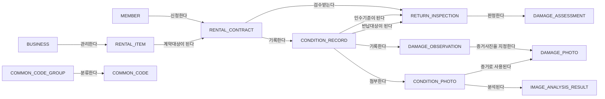

# RentalTrack 새 ERD와 기존 구현 비교

분석일: 2026-11-07. 사용자 제공 모델을 기존 코드와 비교한 작업 문서. 이후 사용자가 새 ERD 중심 재구성과 확정 기록 보존·차수 관리를 선택하여 `sources.local/RentalTrack`의 `codex/rentaltrack-erd-v2` 브랜치에 구현.

## 입력과 읽기 범위

- 새 자료: `C:/Users/SSAFY/Downloads/렌탈트랙 (1).damx`
- 파일 크기: 1,202,388 bytes
- SHA-256: `00c3385b8f23190f32b1b0affdd75adde5fff1c98f6e285f423a1b6ce5fb5273`
- 기존 코드: `sources.local/RentalTrack`, 리팩터링 브랜치 `afedc1b699b5e5d2c125aa839c89e0685e875cbe`. main과 이 브랜치의 구현·마이그레이션은 동일하고 README만 다름.
- 모델의 문자열 레코드에서 엔터티 13개, 컬럼 108개, 관계 객체 14개를 추출. 컬럼명·물리 타입·길이·설명과 관계 양쪽의 엔터티 식별자를 대조함.
- 추출 도구: `review.local/rentaltrack-erd/extract-damx.cjs`; 상세 결과: 같은 폴더의 `schema-observed.json`. 원본 파일은 수정하지 않음.
- 완전한 DAMX 디코더가 아니므로 NULL 허용, UNIQUE, AUTO_INCREMENT, FK 삭제 옵션, 관계의 최소·최대 건수는 확정하지 않음. 아래 타입 목록을 실행용 DDL로 사용하지 않음.
- 코드 항목의 한국어 표시명은 읽었지만 실제 저장할 코드값 전체는 확정하지 않음. 예: '인수'라는 표시명을 곧바로 `INTAKE`라는 코드값으로 간주하지 않음.

## 구조 변경과 코드 영향

| 대상 | 기존 구현 | 새 모델에서 읽은 구조 | 수정 영향 |
| --- | --- | --- | --- |
| 회원·권한 | `member_account`: email 로그인, password_hash, USER/OPERATOR 역할 | `MEMBER`: login_id, member_name, email, member_role_cd. 표시 역할: 일반회원·검수담당자·관리자 | 로그인 식별자, JWT 주체, 회원 조회, 검수 권한 매핑. 비밀번호 저장 위치는 새 모델에 없음 |
| 상품 소유·분류 | rental_product가 category·current_location 참조 | BUSINESS → RENTAL_ITEM, category_cd | 사업자 등록·상품 소유 관계 추가, 상품 검색·대여 요청 DTO 변경. 기존 지점 단위 조회·예측은 별도 범위 결정 필요 |
| 대여 진행 | 승인·인수·이용 시작·반납·검수 단계를 구분 | 계약 상태 표시명: 대여신청·대여중·반납완료·검수완료·대여취소. rental_start_at / rental_end_at / actual_return_at | 현재의 승인·인수 API와 사진 등록 시점을 새 상태 전이에 매핑해야 함. 상태를 단순 치환하면 기존 검사 조건이 깨짐 |
| 상태 기록 | 계약·BEFORE/AFTER 조합당 한 건, 서비스가 동일 기록을 사용 | record_stage_cd + record_revision_no + confirmed_yn | 단일 조회 메서드와 덮어쓰기 흐름을 차수 조회·확정 처리로 변경할지 결정 필요 |
| 사진 | condition_image: 저장 키·촬영 순서·파일 메타데이터 | CONDITION_PHOTO: photo_seq, file_hash CHAR(64), 촬영 방향 코드·메타데이터 | 업로드 시 해시 계산 및 저장, 응답 DTO 변경. 해시만으로 파일 중복을 금지하는 규칙은 모델에서 확인되지 않음 |
| 손상 관찰 | damage_record에 관찰값과 비교 결과, 이전 손상 self FK 함께 저장 | DAMAGE_OBSERVATION에 위치·유형·설명·정도 저장 | 관찰과 판정의 생명주기 분리. 기존 self FK의 매칭 정보를 새 판정으로 옮기는 작업 필요 |
| 손상 증거 | 손상과 사진의 직접 연결 없음 | DAMAGE_PHOTO: damage_id + photo_id + 영역 좌표 비율 | 손상별 여러 사진 연결, 사진 내 영역 저장, 다른 상태 기록의 사진이 섞이지 않도록 검증 |
| 반납 검수 | 계약당 최종 결과, 비교할 기록은 계약과 유형으로 간접 조회 | RETURN_INSPECTION이 인수·반납 condition_id와 inspector_member_id를 직접 보유, 검수 상태·종합 결과 분리 | 검수 기준 기록을 명시적으로 선택하고 같은 계약·올바른 단계인지 검사. 담당자 권한과 진행·완료 시점 구분 |
| 손상 판정 | DamageRecord 내부의 BASELINE/UNRESOLVED/EXISTING/NEW | DAMAGE_ASSESSMENT: 검수·반납 손상·인수 손상·판정 결과·사유 | 기존 유형/위치 자동 매칭은 현재 코드의 동작이며 새 모델의 업무 규칙은 아님. 자동 판정 유지 여부와 수동 변경 흐름 검토 |
| 이미지 분석 | 기존 AI 모듈은 대여 수요 예측용 | IMAGE_ANALYSIS_RESULT: 사진·분석 실행·검출 순번·모델/버전·유형·신뢰도·영역 | 별도 결과 저장 구조. ERD만으로 이미지 모델·학습 데이터·추론 구현이 제공된 것은 아님 |
| 코드 관리 | Java enum + DB CHECK, 별도 카테고리 엔터티 | COMMON_CODE_GROUP + COMMON_CODE | 허용 코드·사용 여부·표시 순서 조회 방식 마련. Java enum과 공통코드 사이의 검증 책임 정리 |

## 모델에 나타난 관계 객체

아래 화살표는 모델에 저장된 관계 객체의 부모→자식 방향만 표현한다. FK 강제 여부나 1:1/1:N을 확정하는 표기가 아니다.

`DAMAGE_ASSESSMENT.intake_damage_id`·`return_damage_id`, `RETURN_INSPECTION.inspector_member_id` 컬럼은 존재하지만 위에서 읽은 14개 관계 객체 중 대응 연결은 발견되지 않았다. 구현 시 각각 DAMAGE_OBSERVATION, MEMBER 참조를 명시적으로 대조해야 한다. 이것만으로 원본 모델의 FK 제약이 없다고 단정하지 않는다.

## 구현 우선순위와 제안 규칙

아래는 구현 제안이며 원본 모델에 명시된 제약이라는 뜻이 아니다.

1. **업무 범위·인증·기존 데이터 처리 결정**
   - 지점·수요 예측을 유지할지, 새 모델 중심으로 제품 범위를 바꿀지 결정.
   - 현재 비밀번호 인증을 유지한다면 인증용 확장 테이블 또는 컬럼에 해시를 보존. ERD에 없다는 이유로 인증을 제거하지 않음.
   - 기존 지점에서 사업자를 자동 추정하지 않음. 데이터가 있다면 상품별 사업자 매핑 필요.
   - 기존 승인·인수 단계와 새 계약 상태의 매핑 결정. RESERVED 제거에 따른 동시 대여 방지 방법도 함께 결정.
2. **상태 기록 차수·확정과 검수 기준 고정**
   - 제안: 계약·단계·차수 조합을 유일하게 관리하고, 확정한 기록은 보존. 수정 시 다음 차수 생성.
   - 제안: 검수의 두 기준 기록은 같은 계약에 속하고, 각각 인수·반납 단계이며 확정된 기록이어야 함.
   - 제안: 검수 진행 후 기준 기록을 바꾸는 행위는 명시적인 재검수로 처리.
3. **손상 관찰·증거·판정 분리**
   - 기존 손상과 비교 결과를 분리하고 원본 식별자를 유지하는 이전 경로 작성.
   - 판정의 반납 손상은 선택한 반납 기록, 인수 손상은 선택한 인수 기록에 속해야 함.
   - 기존 손상 판정은 인수 손상 참조를 요구하고, 신규 손상·판정보류에서의 참조 허용 여부를 정의.
   - 손상 증거 사진과 관찰 기록의 condition_id 일치 검사.
4. **사진·이미지 분석 결과 저장**
   - 원본 저장 키와 파일 해시 관리. 이미지 분석 결과는 검출 후보로 저장하고 최종 검수·판정과 구분.
   - 좌표 비율 0~1, 양의 너비·높이, x+width/y+height ≤ 1, 신뢰도 0~1 검증 제안.
   - 사진·실행·검출 순번의 중복 방지 제안. 모델·버전·분석 시점 보존.
   - 이미지 모델과 실행 계약은 별도 자료가 필요함. 저장 테이블 추가를 AI 추론 구현으로 표현하지 않음.
5. **화면·이력·검증·포트폴리오 동기화**
   - DTO·프런트엔드·회원 이력·권한·공통코드 표시 갱신.
   - 기존 동시 대여·이용 시작 전 사진·반납 검수 테스트를 새 상태 규칙에 맞춰 검증.
   - 차수 충돌, 확정 기록 변경, 다른 계약의 상태/사진/손상 혼입, 판정보류 상태의 완료 차단 검증 추가.
   - 실제 구현·실행 결과에 맞춰 포트폴리오를 개조식으로 수정. 새 설계를 기존 기간에 이미 구현한 기능으로 기재하지 않음.

## 변경 시 보존할 기존 동작

- 동일 개별 상품에 대한 대여 요청의 동시성 제어.
- 실제 이용 시작 전 인수 상태 사진 등록 검사.
- 회원·운영자 접근 권한과 파일 조회 권한.
- 이미지 파일과 DB 메타데이터를 분리한 저장 구조.
- 계약 단위의 상태·사진·손상·검수 이력 연결.

현재 `DamageApplicationService.sameDamage`는 손상 유형과 대소문자를 무시한 위치 문자열이 같으면 기존 손상 후보로 매칭한다. 심각도·사진 위치·이미지 유사도를 비교하는 구현이 아니다. 새 이미지 분석 결과 구조를 기존 자동 매칭 성능의 근거로 사용하지 않는다.

## 진행 상태와 필요한 자료

- 완료: 제공 파일 읽기, 원본 해시 기록, 컬럼·관계 목록 추출, 기존 코드와 변경 영향 대조.
- 사용자 결정: 지점·수요 예측을 활성 기능에서 제외하고 새 ERD 중심 재구성. 확정 기록은 보존하며 수정 시 새 차수를 만들고 검수 기준 기록은 고정.
- 구현: V11 새 스키마·인증 확장·대여/차수/사진/관찰/판정 API·고객/관리자 화면. 구버전 AI 코드는 archive, 기존 문서는 docs/legacy로 보존.
- 구현 커밋: `831c6619416d8e9cfe77f020a7f39803e61e18a2`, [Draft PR #2](https://github.com/WJLee0417/RentalTrack/pull/2). 기존 리팩터링 브랜치로의 병합은 수행하지 않음.
- 인증: member_credential에 기존 방식의 BCrypt·계정 상태 저장. 구버전 회원 ID 공간의 토큰 재사용을 막도록 JWT issuer 분리.
- 데이터: 기존 V1~V10 미수정, 이름이 충돌하는 세 테이블은 legacy_*로 보존. 기존 행을 새 화면에 자동 이전하지 않음. 실제 데이터 이전에는 사업자·상품·회원·상태 대응표 필요.
- 검증: 실제 MySQL 8.4에서 통합 테스트 21개 통과, TypeScript·Vite 빌드 통과, Chrome에서 고객의 차수 작성·대여·반납과 관리자 검수 완료, 1440/390px 화면·가로 넘침 검사 통과.
- 별도 기능 구현 시 필요: 이미지 모델·추론 API 또는 모델 파일, 입력·출력 예시. 현재 제공된 것은 분석 결과의 데이터 구조.
- 차량 경로 최적화 프로젝트: 사용자가 제공 예정인 ZIP 대기.
- 포트폴리오 원본 JSON은 이번 구현 단계에서 수정하지 않음. 기존 수행 기간의 개인 기여와 이번 개선 작업을 혼합하지 않음.

## 컬럼 목록

아래 목록은 원본 모델의 물리 타입 문자열에서 추출. NULL·키·인덱스 제약은 포함하지 않음.

### MEMBER

| 컬럼 | 물리 타입 | 원본 바이트 위치 |
| --- | --- | --- |
| member_id | BIGINT UNSIGNED | 1224 |
| login_id | VARCHAR(50) | 1822 |
| member_name | VARCHAR(100) | 2402 |
| email | VARCHAR(254) | 2978 |
| member_role_cd | VARCHAR(20) | 3594 |
| created_at | DATETIME(3) | 4298 |

### BUSINESS

| 컬럼 | 물리 타입 | 원본 바이트 위치 |
| --- | --- | --- |
| business_id | BIGINT UNSIGNED | 8428 |
| business_no | VARCHAR(10) | 9052 |
| business_name | VARCHAR(200) | 9652 |
| business_status_cd | VARCHAR(20) | 10298 |
| contact_email | VARCHAR(254) | 11002 |
| created_at | DATETIME(3) | 11638 |

### RENTAL_ITEM

| 컬럼 | 물리 타입 | 원본 바이트 위치 |
| --- | --- | --- |
| item_id | BIGINT UNSIGNED | 88868 |
| business_id | BIGINT UNSIGNED | 89490 |
| asset_code | VARCHAR(40) | 90112 |
| item_name | VARCHAR(200) | 90702 |
| category_cd | VARCHAR(30) | 91312 |
| item_status_cd | VARCHAR(20) | 92022 |
| description | VARCHAR(1000) | 92704 |
| created_at | DATETIME(3) | 93344 |

### RENTAL_CONTRACT

| 컬럼 | 물리 타입 | 원본 바이트 위치 |
| --- | --- | --- |
| contract_id | BIGINT UNSIGNED | 38014 |
| contract_no | VARCHAR(50) | 38634 |
| member_id | BIGINT UNSIGNED | 39250 |
| item_id | BIGINT UNSIGNED | 39870 |
| requested_at | DATETIME(3) | 40522 |
| rental_start_at | DATETIME(3) | 41152 |
| rental_end_at | DATETIME(3) | 41796 |
| actual_return_at | DATETIME(3) | 42430 |
| contract_status_cd | VARCHAR(20) | 43094 |
| created_at | DATETIME(3) | 43824 |

### CONDITION_RECORD

| 컬럼 | 물리 타입 | 원본 바이트 위치 |
| --- | --- | --- |
| condition_id | BIGINT UNSIGNED | 56934 |
| contract_id | BIGINT UNSIGNED | 57582 |
| record_stage_cd | VARCHAR(10) | 58224 |
| record_revision_no | INT | 58930 |
| recorded_at | DATETIME(3) | 59580 |
| record_note | VARCHAR(1000) | 60194 |
| confirmed_yn | CHAR(1) | 60806 |
| created_at | DATETIME(3) | 61446 |

### CONDITION_PHOTO

| 컬럼 | 물리 타입 | 원본 바이트 위치 |
| --- | --- | --- |
| photo_id | BIGINT UNSIGNED | 127878 |
| condition_id | BIGINT UNSIGNED | 128518 |
| photo_seq | INT | 129138 |
| storage_key | VARCHAR(500) | 129738 |
| original_file_name | VARCHAR(255) | 130370 |
| mime_type | VARCHAR(100) | 130992 |
| file_size | BIGINT UNSIGNED | 131606 |
| file_hash | CHAR(64) | 132218 |
| capture_angle_cd | VARCHAR(30) | 132838 |
| captured_at | DATETIME(3) | 133528 |
| created_at | DATETIME(3) | 134172 |

### DAMAGE_OBSERVATION

| 컬럼 | 물리 타입 | 원본 바이트 위치 |
| --- | --- | --- |
| damage_id | BIGINT UNSIGNED | 107036 |
| condition_id | BIGINT UNSIGNED | 107684 |
| damage_location_cd | VARCHAR(40) | 108338 |
| damage_type_cd | VARCHAR(40) | 109056 |
| damage_description | VARCHAR(1000) | 109766 |
| severity_cd | VARCHAR(20) | 110410 |
| created_at | DATETIME(3) | 111132 |

### DAMAGE_PHOTO

| 컬럼 | 물리 타입 | 원본 바이트 위치 |
| --- | --- | --- |
| damage_photo_id | BIGINT UNSIGNED | 30658 |
| damage_id | BIGINT UNSIGNED | 31288 |
| photo_id | BIGINT UNSIGNED | 31904 |
| bbox_x_ratio | DECIMAL(5,4) | 32544 |
| bbox_y_ratio | DECIMAL(5,4) | 33182 |
| bbox_width_ratio | DECIMAL(5,4) | 33822 |
| bbox_height_ratio | DECIMAL(5,4) | 34472 |
| created_at | DATETIME(3) | 35124 |

### IMAGE_ANALYSIS_RESULT

| 컬럼 | 물리 타입 | 원본 바이트 위치 |
| --- | --- | --- |
| analysis_result_id | BIGINT UNSIGNED | 15774 |
| photo_id | BIGINT UNSIGNED | 16426 |
| analysis_run_id | CHAR(36) | 17066 |
| detection_seq | INT | 17694 |
| model_name | VARCHAR(100) | 18312 |
| model_version | VARCHAR(50) | 18948 |
| predicted_damage_type_cd | VARCHAR(40) | 19622 |
| confidence_score | DECIMAL(5,4) | 20356 |
| bbox_x_ratio | DECIMAL(5,4) | 21020 |
| bbox_y_ratio | DECIMAL(5,4) | 21676 |
| bbox_width_ratio | DECIMAL(5,4) | 22334 |
| bbox_height_ratio | DECIMAL(5,4) | 23002 |
| analyzed_at | DATETIME(3) | 23636 |

### RETURN_INSPECTION

| 컬럼 | 물리 타입 | 원본 바이트 위치 |
| --- | --- | --- |
| inspection_id | BIGINT UNSIGNED | 65758 |
| contract_id | BIGINT UNSIGNED | 66410 |
| intake_condition_id | BIGINT UNSIGNED | 67086 |
| return_condition_id | BIGINT UNSIGNED | 67778 |
| inspector_member_id | BIGINT UNSIGNED | 68286 |
| inspection_status_cd | VARCHAR(20) | 69094 |
| overall_result_cd | VARCHAR(20) | 69820 |
| inspected_at | DATETIME(3) | 70530 |
| inspection_note | VARCHAR(1000) | 71156 |
| created_at | DATETIME(3) | 71816 |

### DAMAGE_ASSESSMENT

| 컬럼 | 물리 타입 | 원본 바이트 위치 |
| --- | --- | --- |
| assessment_id | BIGINT UNSIGNED | 80258 |
| inspection_id | BIGINT UNSIGNED | 80914 |
| return_damage_id | BIGINT UNSIGNED | 81576 |
| intake_damage_id | BIGINT UNSIGNED | 82244 |
| assessment_result_cd | VARCHAR(20) | 82908 |
| assessment_reason | VARCHAR(1000) | 83626 |
| created_at | DATETIME(3) | 84290 |

### COMMON_CODE_GROUP

| 컬럼 | 물리 타입 | 원본 바이트 위치 |
| --- | --- | --- |
| code_group_id | VARCHAR(40) | 101954 |
| code_group_name | VARCHAR(100) | 102586 |
| code_group_description | VARCHAR(500) | 103244 |
| use_yn | CHAR(1) | 103866 |
| created_at | DATETIME(3) | 104496 |
| updated_at | DATETIME(3) | 105142 |

### COMMON_CODE

| 컬럼 | 물리 타입 | 원본 바이트 위치 |
| --- | --- | --- |
| code_group_id | VARCHAR(40) | 50282 |
| code_value | VARCHAR(40) | 50878 |
| code_name | VARCHAR(100) | 51468 |
| code_description | VARCHAR(500) | 52078 |
| display_order | INT | 52696 |
| use_yn | CHAR(1) | 53274 |
| created_at | DATETIME(3) | 53892 |
| updated_at | DATETIME(3) | 54526 |
