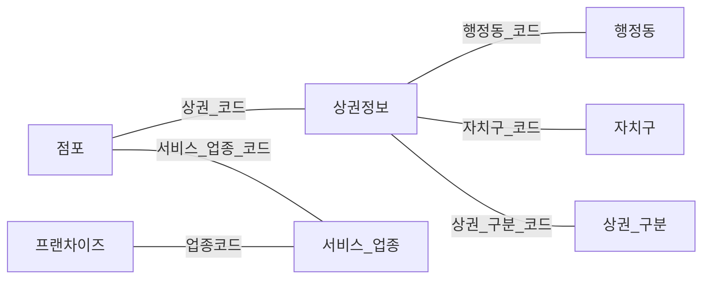

# 7개 관계형 테이블의 개념·논리 ERD

프로젝트: P001 · 자료: E003 · 작성일: 2026-11-07

**자료 유형: 현재 포트폴리오용 재구성 설계·설명 자료**

원본 DDL 기반으로 새로 그린 관계 개념도

## 설계

관계의 표기는 현재 설계 설명에 명시된 범위입니다.

## 수행 내용과 연결

### 함수 종속 검토 및 데이터 정규화

- 문제: 코드에 종속되는 명칭을 여러 데이터에 중복 저장하면 갱신 시 불일치가 발생할 수 있었습니다.
- 판단: 행정동·자치구·상권 구분·서비스업종 등은 별도 관계로 분리했습니다.
- 수행: 함수 종속 관계를 검토하고 테이블 분리 기준을 정했습니다.
- 결과: 갱신 이상을 줄이기 위한 정규화 구조를 정리했습니다.

### MySQL 테이블과 키 관계 설계

- 문제: 상권·점포·프랜차이즈 정보를 관계형 구조로 연결해야 했습니다.
- 판단: 데이터 단위별 테이블과 PK·FK를 정의했습니다.
- 수행: 7개 관계형 테이블의 구조와 관계를 설계하고 SQL DDL을 작성했습니다.
- 결과: MySQL에 상권 데이터 연결을 위한 저장 구조를 마련했습니다.

## 자료 기준

[포트폴리오 설계 데이터 기준 커밋](https://github.com/WJLee0417/wjlee0417.github.io/blob/45fc70cf2b6f3cba5a4f4874f7889ea960d71d4a/portfolio_codex_bundle/portfolio-data.json)

현재 문서는 위 데이터에 있는 설계를 별도 파일로 정리한 산출물입니다. 당시 SQL DDL·Python 코드·운영 기록을 제공하는 파일과는 자료 유형을 구분합니다.
