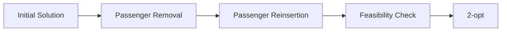

# ALNS 탐색 절차 재구성 도식

프로젝트: P002 · 자료: E010 · 작성일: 2026-11-07

**자료 유형: 현재 포트폴리오용 재구성 설계·설명 자료**

알고리즘 작동 원리의 재구성 예시. 당시 Python 원본 코드를 뜻하지 않음

## 설계

## 수행 내용과 연결

### Python ALNS 제거·삽입 탐색 구현

- 문제: 승객과 경유지가 늘어나면 가능한 배정·방문 순서 조합이 증가합니다.
- 판단: 기존 해의 일부를 제거하고 제약을 확인하며 다시 삽입하는 ALNS를 사용했습니다.
- 수행: Python으로 승객 제거·재삽입 연산과 반복 탐색 흐름을 구현했습니다.
- 결과: 규모가 큰 문제에서 후보 경로를 반복 탐색하는 해법을 작성했습니다.

### 2-opt 경로 개선 로직 구현

- 문제: 승객 재배정 후에도 경로 내부 방문 순서를 조정할 여지가 있었습니다.
- 판단: 제약조건을 확인하며 경로의 일부 방문 순서를 바꾸는 2-opt를 적용했습니다.
- 수행: Python에서 2-opt 후보 경로를 만들고 비용·제약조건을 확인하는 로직을 구현했습니다.
- 결과: 방문 순서 개선을 위한 지역 탐색 과정을 마련했습니다.

## 자료 기준

[포트폴리오 설계 데이터 기준 커밋](https://github.com/WJLee0417/wjlee0417.github.io/blob/45fc70cf2b6f3cba5a4f4874f7889ea960d71d4a/portfolio_codex_bundle/portfolio-data.json)

현재 문서는 위 데이터에 있는 설계를 별도 파일로 정리한 산출물입니다. 당시 SQL DDL·Python 코드·운영 기록을 제공하는 파일과는 자료 유형을 구분합니다.
