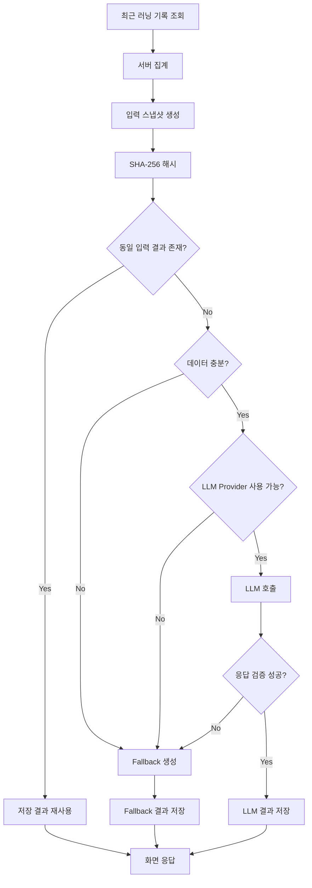

# AI Running Report

## Purpose

러닝 기록은 거리, 시간, 페이스, 케이던스, 심박처럼 숫자 중심으로 쌓입니다. AI 러닝 리포트는 이 데이터를 사용자가 읽기 쉬운 문장으로 정리하되, 수치 계산 자체를 LLM에 맡기지 않는 구조로 설계했습니다.

## Processing Flow



## Server-side Aggregation

LLM 호출 전에 Backend가 다음 항목을 먼저 계산합니다.

- 분석 기간
- 러닝 기록 개수
- 총·평균 거리
- 총·평균 운동 시간
- 평균 페이스
- 케이던스 평균·최소·최대·누락 수
- 심박 평균·최소·최대·누락 수
- 최근 기록의 변화 방향
- 데이터 부족 항목

LLM에는 계산된 집계 JSON을 전달하고, 새로운 수치를 임의로 만들어내지 않도록 제한합니다.

## Privacy Boundary

프롬프트 입력에서 다음 식별 정보는 제외합니다.

- 회원 ID
- 이메일
- 닉네임
- API Key

심박과 케이던스는 운동 기록 참고 정보로만 사용하며 건강 상태나 의료적 판단으로 해석하지 않도록 프롬프트 제약을 둡니다.

## Cache and Traceability

입력 스냅샷은 해시와 함께 저장합니다.

```text
running data
→ normalized snapshot
→ input_snapshot_hash
→ existing report lookup
```

동일한 데이터에 대해 리포트를 반복 생성하지 않고 저장 결과를 재사용할 수 있습니다. 결과에는 생성 출처, Provider, 모델, 프롬프트 버전 등의 메타데이터를 함께 저장합니다.

## Fallback

다음 상황에서는 외부 LLM 대신 서버 fallback 결과를 사용합니다.

- AI 기능 비활성화
- API Key 또는 Provider 미설정
- 데이터 부족
- Timeout
- 외부 API 오류
- 응답 JSON 파싱·검증 실패

따라서 외부 LLM은 핵심 서비스 실행의 단일 실패 지점이 아닙니다.

## Configuration

외부 LLM 호출은 기본값에서 비활성화되어 있습니다.

```text
AI_RUNNING_REPORT_ENABLED=false
AI_RUNNING_REPORT_PROVIDER=none
AI_RUNNING_REPORT_API_KEY=
```

활성화할 경우 API Key는 로컬 환경변수 또는 Secret 관리 영역에서만 주입합니다.
