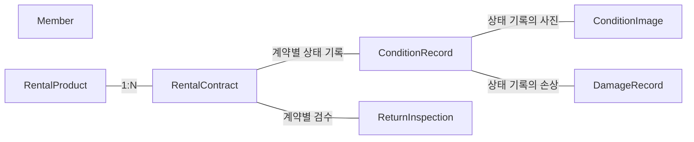

# 상품·계약·상태 기록 관계 개념도

프로젝트: P004 · 자료: E024 · 작성일: 2026-11-07

**자료 유형: 현재 포트폴리오용 재구성 설계·설명 자료**

개념적 엔터티 관계. 원본 DDL/물리 테이블명 아님

## 설계

관계의 표기는 현재 설계 설명에 명시된 범위입니다.

Member의 세부 연결과 별도로 명시하지 않은 카디널리티·키는 이 자료에서 정의하지 않습니다.

## 수행 내용과 연결

### 상품과 대여계약 중심 엔터티 관계 설계

- 문제: 하나의 상품이 여러 번 대여될 때 상품 단위 정보만으로 계약 이력을 구분하기 어렵습니다.
- 판단: 상품과 개별 대여계약을 분리했습니다.
- 수행: 상품·계약·상태·사진·손상·검수 개념 엔터티의 관계를 정리했습니다.
- 결과: 계약 중심 데이터 관계 개념도를 구성했습니다.

### 계약별 전·후 상태·사진 이력 설계

- 문제: 상태 사진과 손상을 상품에만 묶으면 대여 기간별 기록이 섞일 수 있습니다.
- 판단: 상태 기록을 계약별 인수·반납 시점으로 구분했습니다.
- 수행: 상태 기록·사진·손상 위치를 계약과 연결하는 데이터 관계를 설계했습니다.
- 결과: 계약별 전·후 상태를 비교할 수 있는 이력 구조를 정리했습니다.

## 자료 기준

[포트폴리오 설계 데이터 기준 커밋](https://github.com/WJLee0417/wjlee0417.github.io/blob/45fc70cf2b6f3cba5a4f4874f7889ea960d71d4a/portfolio_codex_bundle/portfolio-data.json)

현재 문서는 위 데이터에 있는 설계를 별도 파일로 정리한 산출물입니다. 당시 SQL DDL·Python 코드·운영 기록을 제공하는 파일과는 자료 유형을 구분합니다.
